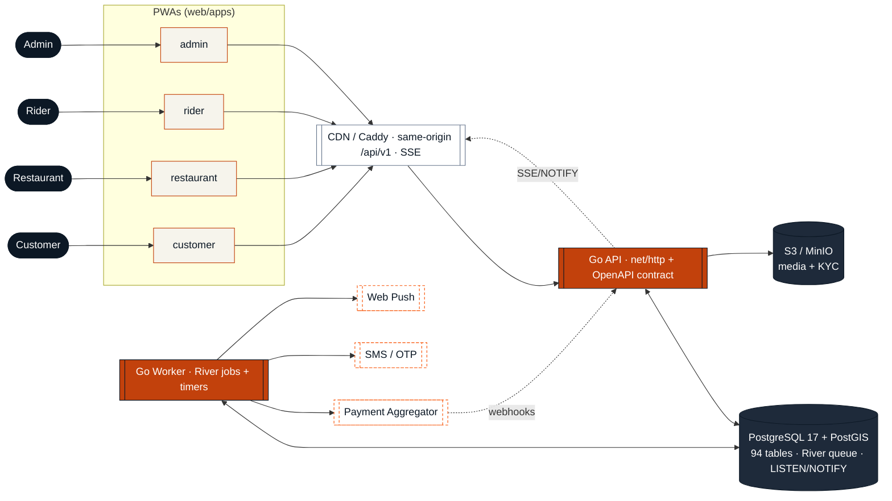
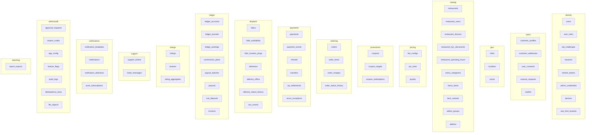
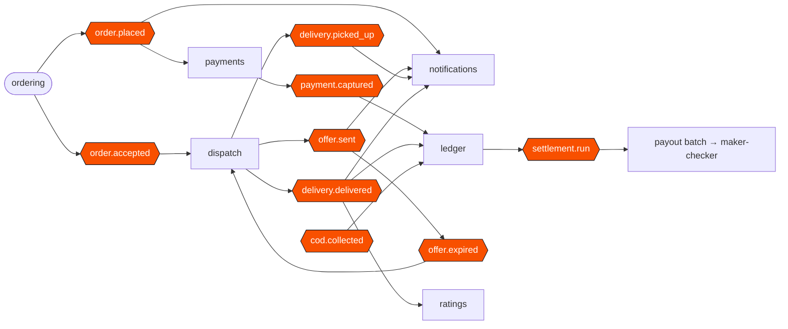
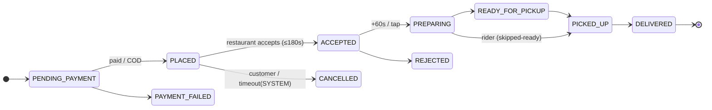

# rovo — System Knowledge Graph

| | |
|---|---|
| **Updated** | 2026-10-21 |
| **Source** | Generated from the live artifacts: `backend/migrations/*` (94 tables), `openapi/openapi.yaml` (API tag groups), and the module boundaries in `docs/implementation/00-implementation-charter.md` + planning docs 08/10/11/13. |
| **Scope** | The nodes and edges of V1: actors → apps → API groups → domain modules → owned tables → domain events → external systems. |

This is a hand‑verifiable knowledge graph (not an auto‑generated black box): every table below is grepped from the migrations, every API group from the OpenAPI tags. Regenerate the mappings with `scripts/knowledge-graph.sh` (greps the same sources).

## 1. System graph (actors → apps → API → modules → stores)

## 2. Modules ↔ owned tables (verified from migrations)

Each module owns its tables; cross‑module references are logical except FKs to `cities`/`users` and money‑path FKs to `orders` (ruling R41).

**Full table counts by migration** (94 total): geo/users/identity 18 · catalog 16 · pricing/promotions 6 · ordering 4 · payments 8 · dispatch 9 · ledger 12 · ratings/support/notifications 9 · admin/platform 9 · (+ extensions/reference/grants).

## 3. Domain‑event graph (the golden flow)

Events are River jobs inserted transactionally (the outbox, R22/R42). Edges = "emits → consumed by".

**Reads:** placing an order notifies + starts payment; capture posts to the ledger; acceptance creates a delivery and starts the offer cascade (45 s → expire → next rider); delivery completion posts rider/commission entries, opens the rating window, and notifies; COD collection posts cash‑in‑hand; the weekly settlement run produces payout batches that require two‑person approval.

## 4. Order ↔ delivery state machines (reference)

Canonical names (`00` §2); full transition tables in planning doc 13.

## 5. API surface (OpenAPI tag groups → module)

| API group(s) | Module(s) |
|---|---|
| Public, Config | geo, catalog |
| Auth, Me, Customer Addresses | identity, users |
| Checkout | pricing, promotions, ordering |
| Orders, Support | ordering, support |
| Payments, Webhooks | payments |
| Partner Onboarding/Restaurant/Menu/Orders | catalog, ordering |
| Rider, Rider Deliveries | dispatch |
| Admin Dashboard/Orders/Users/Restaurants/Riders/Finance/Coupons/Geography/Support/Approvals/Reports/Audit | adminaudit + all modules |
| Realtime | realtime (SSE) |
| Health | platform/health |

## 6. External systems (trust boundaries)

| Node | Direction | Notes |
|---|---|---|
| Payment Aggregator | out + inbound webhook | HMAC‑verified, fetch‑to‑confirm; `api.` host receives webhooks only (R55) |
| SMS / OTP | out | India mobiles, rate‑limited, fake in dev |
| Web Push | out | VAPID, fake in dev |
| S3 / MinIO | out | media (public) + KYC (private, SSE‑KMS) |
| OTel / Grafana | out | traces/metrics/logs |

---

*Generated by the rovo implementation team from the repo's own migrations and OpenAPI spec. Re‑run `scripts/knowledge-graph.sh` after schema or contract changes to refresh the tables in §2 and §5.*
